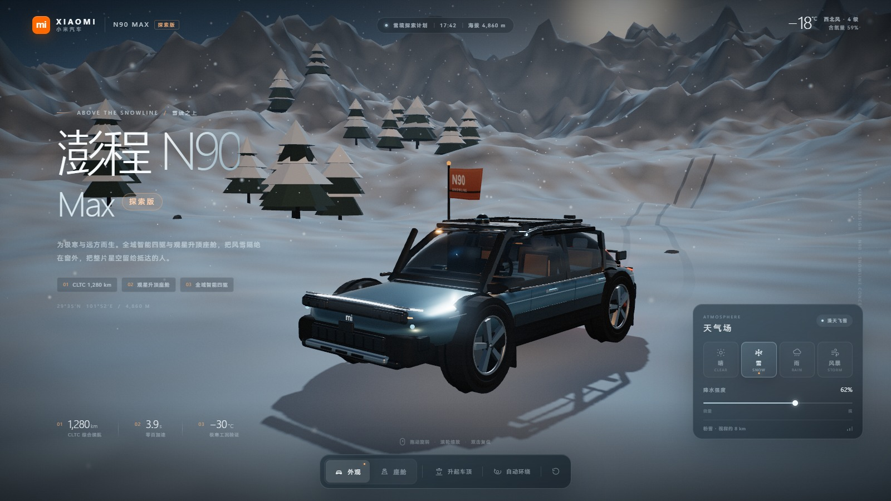
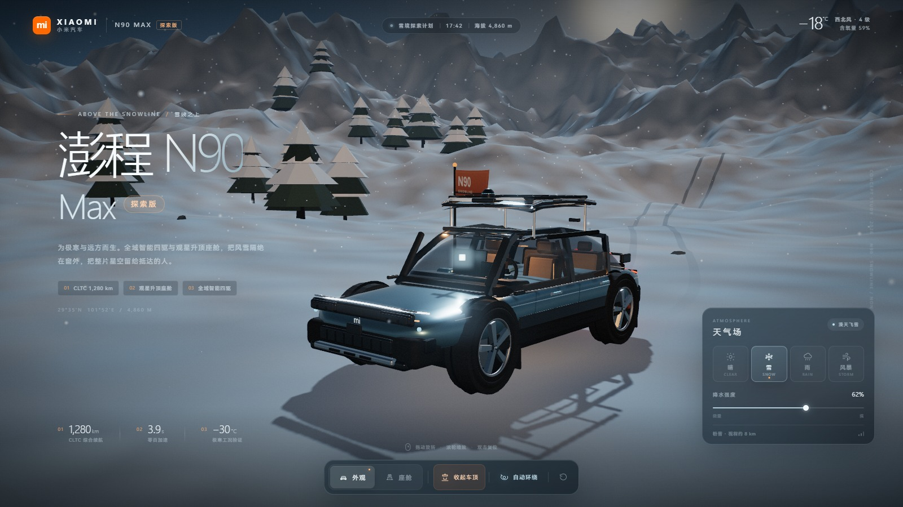
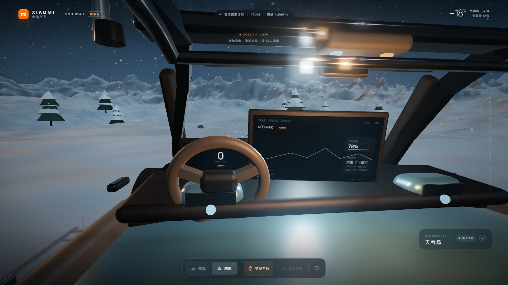
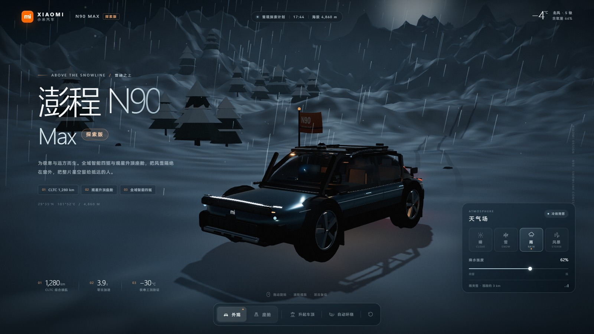
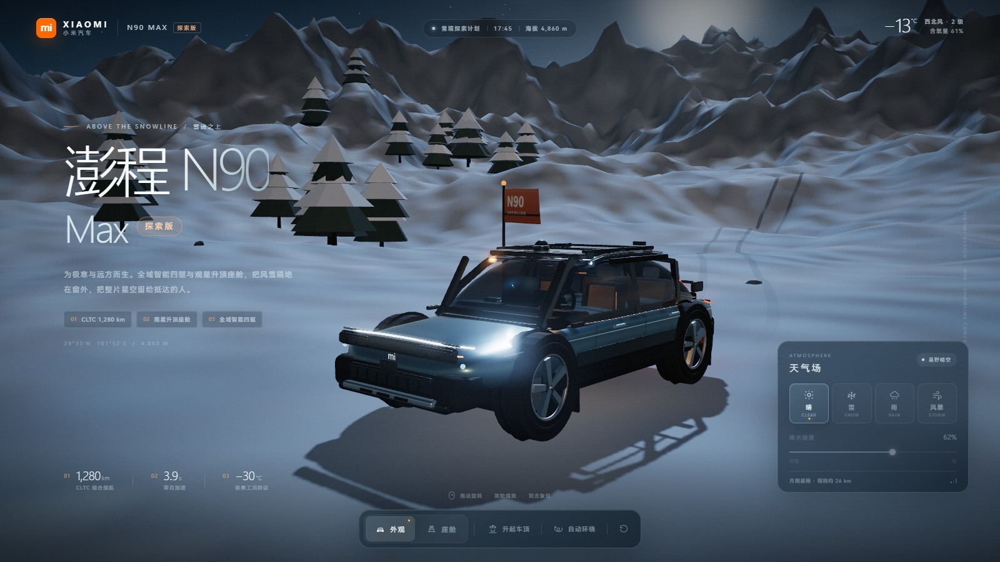

# 澎湃雪线 · Xiaomi 澎程 N90 Max 探索版

一个完全程序化生成、可直接在浏览器中运行的 3D 雪境探索场景。画面围绕一台「澎程 N90 Max 探索版」概念车展开：雪线之上、蓝调时刻的群山与针叶林，车厢暖光透过深色玻璃，车顶可升起，天气可在晴、雪、雨、风暴间切换。

> 这是基于用户设想的非官方概念演示。车辆名称、参数与页面视觉均为概念创作，不代表小米官方产品或发布信息。
>
> **归档状态：**本场景已归档，保留在 `projects/n90-snowline/`，仍可通过本地服务器访问。

## 画面预览











## 启动方式

需要本机安装 **Node.js 18+**。本场景由仓库根目录的共享服务器托管，页面使用 ES Modules，不能直接双击 `index.html` 打开。

在仓库根目录执行：

```bash
npm start
```

或双击根目录的 `start.cmd`。然后访问：

**http://127.0.0.1:4173/projects/n90-snowline/**

关闭服务时结束对应的 Node 进程即可。

## 操作说明

| 操作 | 效果 |
| --- | --- |
| 拖动画面 / 单指拖动 | 环绕车辆，转动方向与视角 |
| 滚轮 / 双指捏合 | 拉近、拉远 |
| 双击画面 | 复位到默认产品视角 |
| 天气：晴 / 雪 / 雨 / 风暴 | 切换天空、光照、雾、降水与氛围 |
| 降水强度滑杆 | 控制雪 / 雨粒子密度与风势 |
| 外观 / 座舱 | 在车外视角与驾驶座视角之间切换 |
| 座舱内拖动 | 在座椅上环顾四周 |
| `Esc` 或「外观」 | 离开座舱 |
| 升起车顶 / `R` | 升起或回收观星升顶，带液压支撑动画 |
| 自动环绕 / `O` | 开启或暂停缓慢的电影式环绕 |
| `1` `2` `3` `4` | 晴、雪、雨、风暴 |
| `C` | 进入 / 离开座舱 |
| `0` 或 `F` | 复位视角 |

下雨或风暴来临且车顶处于升起状态时，升顶会自动收起。座舱状态下自动环绕会被禁用，天气面板会折叠为更安静的浮动控件。

## 场景与技术实现

- **纯程序化资产**：没有外部模型、贴图或字体请求；雪地、山体、天空、针叶林、轮胎痕迹、车标与车内屏幕都用几何体或 Canvas 生成。
- **车外与车内**：完整的外观、玻璃座舱、轮毂/刹车、灯组、车顶行李架、内饰、座椅、方向盘、仪表与中控屏、氛围灯。
- **升顶机构**：黑色全景顶盖由四根液压支撑升起，露出座舱与夜空；下雨/风暴会自动回收。
- **天气状态机**：颜色、雾密度、方向光、半球光、曝光、Bloom、粒子、风与路面反照率平滑过渡；雨/风暴带偶发闪电。
- **电影级渲染**：ACES Filmic 色调映射、HDR Bloom、细颗粒、暗角、轻微色差与冷暗部 / 暖高光调色；宽画幅镜头、电影式开场推进。
- **交互相机**：OrbitControls 环绕、惯性阻尼、自动环绕、复位过渡、座舱自由环顾。
- **响应式**：桌面与移动端各自构图；移动端使用更轻的粒子与阴影参数，天气面板可折叠，保留主要操作。

## 目录结构

```text
projects/n90-snowline/
├─ index.html              # 页面结构与 UI
├─ styles.css              # 视觉系统、响应式与载入动画
├─ js/
│  ├─ main.js              # 渲染管线、相机、UI、天气与座舱状态
│  ├─ world.js             # 雪地、群山、天空、植被、天气粒子
│  ├─ vehicle.js           # N90 Max 外观、灯光、内饰、升顶机构
│  └─ utils.js             # 噪声、缓动、Canvas 纹理工具
├─ preview/                # 截图
└─ README.md
```

仓库级共享资源：Three.js r169 与 addons 位于 `shared/vendor/three/`（离线可用），启动服务器位于仓库根目录。

## 浏览器兼容

- 需要 **WebGL 2**；推荐最新版 Chrome、Edge 或 Safari。
- 首次载入需要在本地生成地形与纹理，桌面端通常 1–3 秒、移动端稍长；载入页会给出进度提示。
- 若帧率偏低，可关闭其他 GPU/视频标签页。页面会自动限制像素比，移动端关闭多重采样抗锯齿。
- 所有天气、升顶、座舱切换都有对应快捷键与可读的无障碍状态提示。

## 说明

这是一件交互式 3D 概念作品，而非汽车销售页面。续航、加速、极寒验证等参数为氛围叙事所需的概念数字；车辆形象与品牌元素仅用于用户指定的设计概念。
