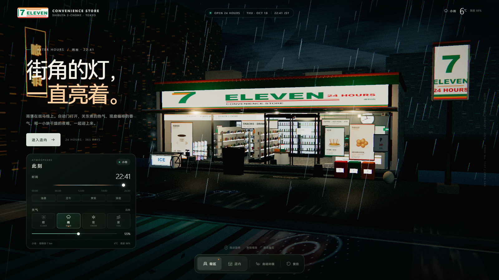
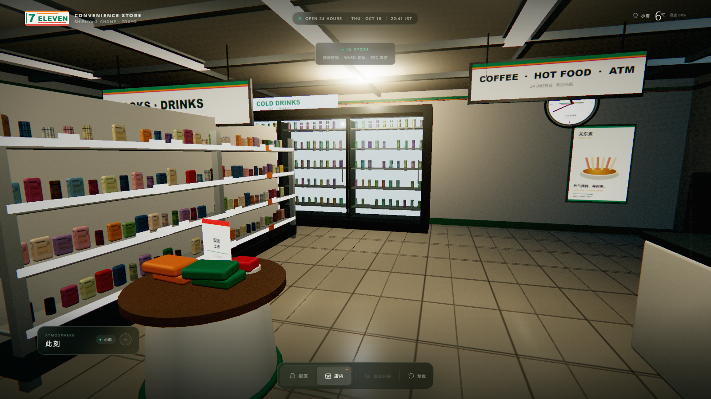
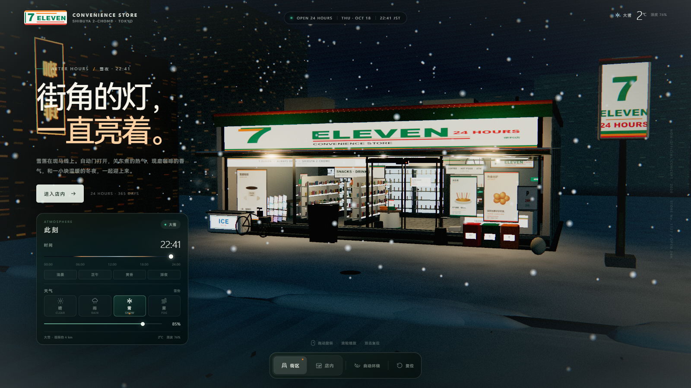

# AFTER HOURS · 街角 7-ELEVEN

一个完全程序化生成的 3D 街角便利店网页场景。电影感夜景、可调时间与天气、可自由环视的街区和可步入的店内空间。

> **非官方概念作品。** 本项目为个人视觉实验，与 7-Eleven / Seven & i Holdings 没有任何隶属、授权或合作关系。场景中的门店、陈设与文案均为虚构。



## 体验入口

本场景位于 `projects/seven-eleven/`，由仓库根目录的共享服务器托管。在仓库根目录执行：

```bash
npm start
```

或双击根目录的 `start.cmd`。打开：

**http://127.0.0.1:4173/projects/seven-eleven/**

无需联网，所有几何体、贴图、产品包装与招牌都在浏览器中实时生成；Three.js r169 与 addons 已放在仓库共享的 `shared/vendor/three/` 目录。

## 场景内容

- **雨夜街角**：默认 22:41、小雨、湿沥青、霓虹倒影、斑马线、街灯、电线、城市天际线与雾气。
- **天气系统**：晴 / 雨 / 雪 / 雾，强度滑杆连续调整；雨雪粒子、地面积水、积雪、能见度与天空颜色会平滑过渡。
- **时间系统**：00:00–24:00 连续时间滑杆 + 清晨、正午、黄昏、深夜四个快捷时间。天空、太阳/月亮方向、阴影、窗灯、招牌亮度、色温与曝光均随时间变化。
- **便利店外观**：白色灯箱招牌、绿色/橙色/红色品牌条纹、玻璃幕墙、自动感应门、门口地垫、灯箱立牌、自行车、冰柜、分类垃圾桶、自动售货细节与积雪。
- **店内空间**：可推门走入。包含瓷砖地面、顶灯、双面零食货架、冷柜饮料墙、收银台、热食柜、咖啡机、关东煮、ATM、杂志架、窗边吧台、促销台、菜单与时钟。
- **自动门**：靠近时自动滑开，离开后合上。
- **自适应画质**：动态检测帧率并在内部渲染分辨率之间调整，尽量保持镜头操作流畅；UI 始终以原生分辨率绘制。

### 店内



### 雪夜



## 操作

### 街区

| 操作 | 效果 |
| --- | --- |
| 拖动 | 旋转视角 |
| 滚轮 / 双指 | 缩放 |
| 双击画布 | 视角复位 |
| `进入店内` / `店内` 按钮 / `E` | 进入便利店 |
| `O` | 自动环绕 |
| `R` | 复位视角 |
| `1` `2` `3` `4` | 晴 / 雨 / 雪 / 雾 |

### 店内

| 操作 | 效果 |
| --- | --- |
| 拖动 | 环视 |
| `W A S D` / 方向键 | 移动 |
| `ESC` / `街区` 按钮 | 离店 |
| `R` | 回到入口视角 |

手机端进入便利店后可拖动环视；点底部「街区」离店。

## 技术说明

- Three.js r169，ES Modules + importmap，本地 vendored。
- 全程序化 Canvas 纹理与几何体；无外部图片、字体或 CDN 依赖。
- `EffectComposer`：MSAA HalfFloat 渲染目标 → UnrealBloom → 自定义电影调色（冷暗部、暖高光、暗角、颗粒、轻微色差）→ OutputPass（ACES）。
- 静态阴影贴图优化：只有太阳方向变化时刷新阴影，避免每帧重建。
- 自适应内部分辨率：根据实时帧率在安全范围内调整，移动端关闭 MSAA。
- 预设状态、UI、粒子、灯光、招牌和地面反射全部在浏览器内联动。

## 目录

```text
projects/seven-eleven/
├─ index.html               # 街角 7-ELEVEN 场景
├─ styles.css               # HUD / 面板 / 响应式样式
├─ js/
│  ├─ main.js               # 渲染、相机、交互、时间天气、后期、UI
│  ├─ world.js              # 天空、城市、街道、雨雪、积水、城市灯光
│  ├─ store.js              # 便利店建筑、店内、商品、招牌、自动门与道具
│  └─ utils.js              # 随机数、缓动、噪声、Canvas 纹理工具
├─ preview/                 # 截图
└─ README.md
```

仓库根目录的 `server.cjs` / `package.json` / `start.cmd` 负责统一启动所有场景；共享 Three.js 位于 `shared/vendor/three/`。

### 归档场景

之前的「小米澎程 N90 Max 探索版 · 雪山」场景已归档到 `projects/n90-snowline/`：

**http://127.0.0.1:4173/projects/n90-snowline/**

其内部 importmap 已指向仓库共享的 `shared/vendor/three/`。

## 浏览器

推荐最新版 Chrome / Edge / Safari / Firefox，启用硬件加速。场景使用 WebGL 2、HDR 后期与 InstancedMesh；若设备较弱，自适应分辨率会自动降档。

## 说明

- 所有品牌视觉均为概念性再设计，仅用于前端图形与场景构建练习。
- 场景默认使用虚构地址「SHIBUYA 2-CHOME · TOKYO」、店号 `1127` 与虚构日期。
- 时间/天气为氛围控制，并非真实气象或天文模拟。
